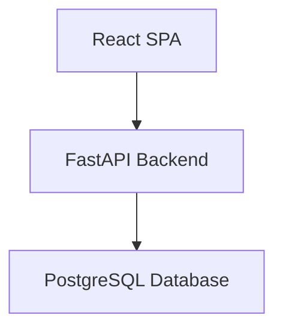
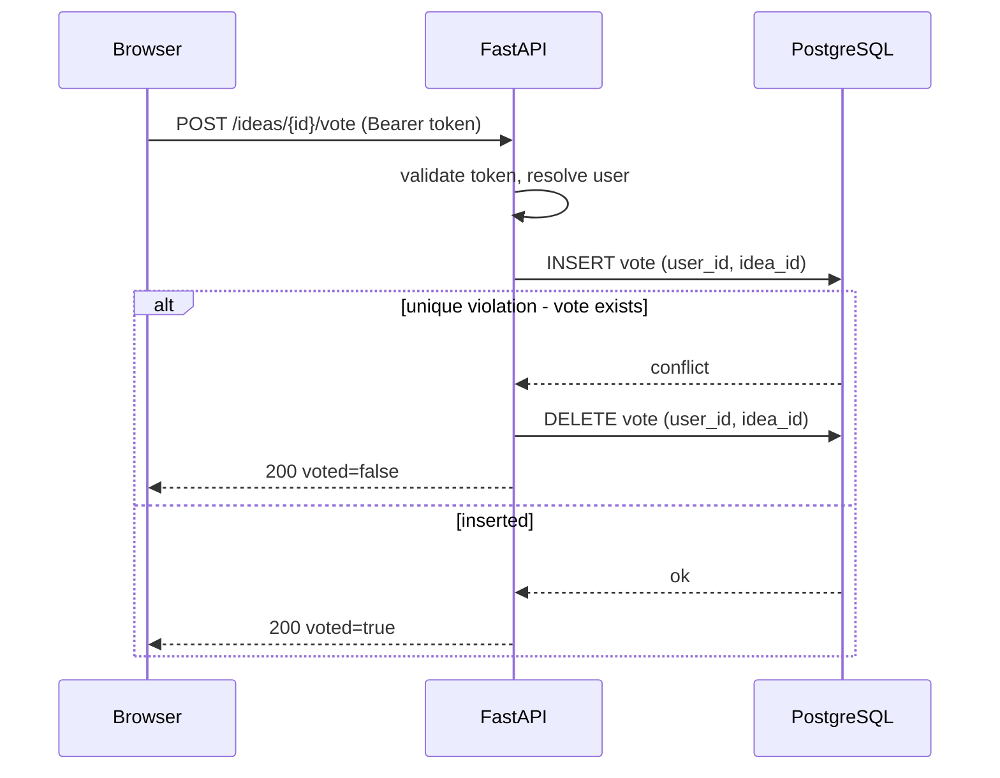
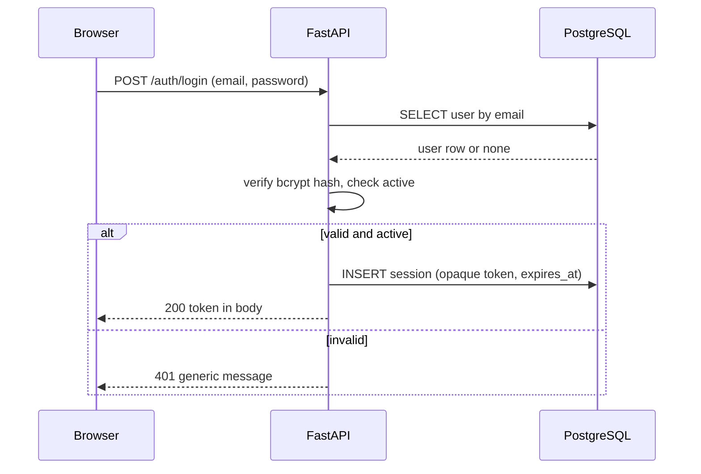
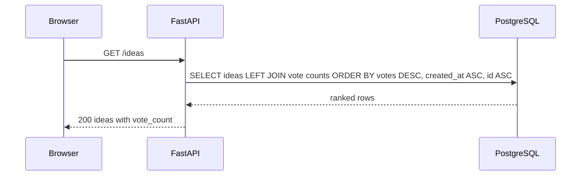
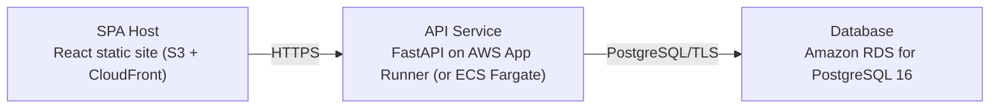

# Architecture

> Maintained by QuorQ AI SDLC. Text between `sdlc:auto` markers is regenerated; anything outside them is yours and is kept.

<!-- sdlc:auto:start narrative -->
## Overview

### ARCH-OVERVIEW · approved · source: architecture:summary

Lightweight Idea Voting Board: public board ranked by upvotes, with registered users able to post/edit/delete ideas and toggle upvotes, plus admin moderation.

Approved v1 architecture. React 19 SPA (separate origin) lets anyone browse ideas ranked by upvotes and lets registered users post, edit, delete, and toggle upvotes. FastAPI 0.115 API (separate origin) handles email/password registration, opaque-token server-side sessions sent as Authorization: Bearer, idea CRUD with author ownership, one-vote-per-user-per-idea enforced by a PostgreSQL 16 unique constraint, and admin moderation (remove any idea, deactivate users). Hosted on AWS with managed PostgreSQL; no email service, no payments; sized for hundreds of users.

**Related:** ARCH-COMPONENT-WEB, ARCH-COMPONENT-API, ARCH-COMPONENT-DB

### ARCH-COMPONENT-WEB · approved · source: architecture:components:web

React 19 single-page app serving the public board and all authenticated idea/vote actions.

Component: web (React SPA, React 19). Responsive public board, auth screens, post/edit/delete idea forms, upvote toggle. Stores the opaque session token and sends it as Authorization: Bearer on every API call. Reads API base URL from VITE_API_BASE_URL. Hosted on its own origin.

**Related:** ARCH-COMPONENT-API

### ARCH-COMPONENT-API · approved · source: architecture:components:api

FastAPI backend providing auth, idea CRUD, vote toggling, and admin moderation.

Component: api (FastAPI Backend, FastAPI 0.115). REST API for registration/login/logout, idea CRUD with author ownership, upvote toggle with one-vote-per-user rule, and admin moderation. Issues and validates opaque session tokens and enforces their expiry/revocation.

**Related:** ARCH-COMPONENT-WEB, ARCH-COMPONENT-DB

### ARCH-COMPONENT-DB · approved · source: architecture:components:db

PostgreSQL 16 database holding users, ideas, votes, and sessions.

Component: db (PostgreSQL Database, PostgreSQL 16). Stores users, ideas, votes and sessions. Enforces one upvote per user per idea with a unique constraint and ranks ideas by vote count.

**Related:** ARCH-COMPONENT-API

### ARCH-CRITICALPATH-AUTH · approved · source: architecture:critical_paths:register_login

Registration and login issue opaque, expiring session tokens used for all authenticated calls.

A visitor registers with a unique email and a rules-compliant password, stored only as a bcrypt hash. Login verifies the hash, creates a session row with an opaque token and expiry, and returns the token in the body for the SPA to store.

**Related:** ARCH-COMPONENT-API, ARCH-COMPONENT-DB, ARCH-DATAMODEL

### ARCH-CRITICALPATH-VOTE · approved · source: architecture:critical_paths:toggle_upvote

Upvote toggling is race-safe: at most one vote per user per idea even under concurrent clicks.

A logged-in user upvotes an idea; a second concurrent click must not create a duplicate vote. A unique (user_id, idea_id) constraint guarantees at most one vote even under concurrent inserts; toggling off deletes the vote. Upvote count is derived from the votes table.

**Related:** ARCH-COMPONENT-API, ARCH-COMPONENT-DB, ARCH-DATAMODEL, ARCH-TECH-DB

### ARCH-CRITICALPATH-LIST · approved · source: architecture:critical_paths:list_ideas

Public idea list is ranked by vote count with a deterministic tie-break for stable ordering.

Anyone loads the public board; ideas are returned ordered by vote count descending with a deterministic tie-break on created_at then id for stable order across reloads. Empty board returns an empty list the SPA renders as an empty state.

**Related:** ARCH-COMPONENT-API, ARCH-COMPONENT-WEB

### ARCH-DATAMODEL · approved · source: architecture:entities

Relational data model: users, ideas, votes, sessions.

users: id, email, password_hash, is_admin, is_active, created_at. ideas: id, author_id, title, description, created_at, updated_at. votes: id, user_id, idea_id, created_at. sessions: token, user_id, created_at, last_active_at, expires_at.

**Related:** ARCH-COMPONENT-DB

### ARCH-API-ENDPOINTS · approved · source: architecture:endpoints

Full REST contract for auth, idea CRUD, voting, and admin moderation.

POST /auth/register - create account with valid unused email and rules-compliant password, stored as bcrypt hash, usable immediately. POST /auth/login - verify credentials for an active account, start a session, return opaque token in body. POST /auth/logout - revoke current session token server-side. GET /auth/me - return current user for the token, or 401 if expired/revoked. GET /ideas - public list ranked by vote count desc with deterministic tie-break; empty list when none exist. POST /ideas - create idea with non-empty title/description within length limits, attributed to caller, starts at zero votes. PATCH /ideas/{id} - edit own idea's title/description; refused if not author. DELETE /ideas/{id} - delete own idea (or any idea if admin); cascades its votes. POST /ideas/{id}/vote - toggle caller's upvote; idempotent per user via unique constraint. GET /admin/ideas - admin-only list of all ideas regardless of author for moderation. POST /admin/users/{id}/deactivate - admin-only deactivation; user can no longer log in and existing sessions are ended.

**Related:** ARCH-COMPONENT-API, ARCH-DATAMODEL, ARCH-CRITICALPATH-AUTH, ARCH-CRITICALPATH-VOTE, ARCH-CRITICALPATH-LIST

### ARCH-DEPLOYMENT · approved · source: architecture:deployment_nodes

Three-node AWS deployment: static SPA host, managed API service, managed Postgres.

SPA Host: React static site on S3 + CloudFront serving static assets. API Service: FastAPI on AWS App Runner (or ECS Fargate), running Python 3.12 / Uvicorn. Database: Amazon RDS for PostgreSQL 16, managed.

**Related:** ARCH-COMPONENT-WEB, ARCH-COMPONENT-API, ARCH-COMPONENT-DB, ARCH-TECH-CLOUD

### ARCH-TECH-FRONTEND · approved · source: architecture:technology_decisions:frontend

React 19 chosen over Vue/Svelte for the live-resorting idea list and one responsive codebase.

Approved stack. Renders the interactive, live-resorting idea list well and serves one responsive codebase for phone and desktop widths (NFR-009). Built as a Vite SPA hosted on its own origin, storing the session token and sending it as a Bearer header. Alternatives considered: Vue, Svelte.

**Related:** ARCH-COMPONENT-WEB, NFR-009

### ARCH-TECH-BACKEND · approved · source: architecture:technology_decisions:backend

FastAPI 0.115 chosen over Flask/Express for low-overhead CRUD, auth, and validation.

Approved stack. Covers register/login/logout, idea CRUD with ownership, and vote toggling with low overhead; Pydantic validation enforces email and length rules, and dependencies enforce auth, ownership and admin checks. Alternatives considered: Flask, Express.

**Related:** ARCH-COMPONENT-API, ARCH-API-ENDPOINTS

### ARCH-TECH-DB · approved · source: architecture:technology_decisions:database

PostgreSQL 16 chosen over MySQL/SQLite for relational modeling and a concurrency-safe unique constraint.

Approved stack. The data is relational (users, ideas, votes) and a UNIQUE(user_id, idea_id) constraint enforces one vote per user per idea even under concurrent clicks (NFR-008); ranking by vote count is trivial. Alternatives considered: MySQL, SQLite.

**Related:** ARCH-COMPONENT-DB, ARCH-CRITICALPATH-VOTE, NFR-008

### ARCH-TECH-CLOUD · approved · source: architecture:technology_decisions:cloud

AWS chosen over GCP/Azure for a cheap hundreds-of-users deployment with encryption at rest and in transit.

Approved stack. S3+CloudFront for the SPA, App Runner/Fargate for the API, and managed RDS PostgreSQL run a hundreds-of-users board cheaply (NFR-011) with encryption at rest and in transit. Alternatives considered: Google Cloud, Azure.

**Related:** ARCH-DEPLOYMENT, NFR-011
<!-- sdlc:auto:end narrative -->

<!-- sdlc:auto:start building-blocks -->
## Building Block View

| ID | Name | Technology | Responsibility | Depends on |
|---|---|---|---|---|
| web | React SPA | React 19 | Responsive public board, auth screens, post/edit/delete idea forms, upvote toggle; stores the opaque session token and sends it as Authorization: Bearer on every API call; reads API base URL from VITE_API_BASE_URL. | api |
| api | FastAPI Backend | FastAPI 0.115 | REST API for registration/login/logout, idea CRUD with author ownership, upvote toggle with one-vote-per-user rule, admin moderation; issues and validates opaque session tokens and enforces expiry/revocation. | db |
| db | PostgreSQL Database | PostgreSQL 16 | Stores users, ideas, votes and sessions; enforces one upvote per user per idea with a unique constraint and ranks ideas by vote count. | — |

<!-- sdlc:auto:end building-blocks -->

<!-- sdlc:auto:start runtime -->
## Runtime View

### Toggle upvote (one vote per user per idea)

A logged-in user upvotes an idea; a second concurrent click must not create a duplicate vote. A unique (user_id, idea_id) constraint guarantees at most one vote even under concurrent inserts; toggling off deletes the vote. Upvote count is derived from the votes table.

- **Components:** web, api, db
- **Modules:** routers/votes.py, services/vote_service.py, models/vote.py, deps/auth.py
- **Key functions:** toggle_vote(user_id, idea_id), get_current_user(token), count_votes(idea_id)

### Register and login with opaque session token

A visitor registers with a unique email and a rules-compliant password, stored only as a bcrypt hash. Login verifies the hash, creates a session row with an opaque token and expiry, and returns the token in the body for the SPA to store.

- **Components:** web, api, db
- **Modules:** routers/auth.py, services/auth_service.py, models/user.py, models/session.py
- **Key functions:** register(email, password), login(email, password), create_session(user_id), verify_password(raw, hash)

### List ideas ranked by upvotes

Anyone loads the public board; ideas are returned ordered by vote count descending with a deterministic tie-break on created_at then id for stable order across reloads. Empty board returns an empty list the SPA renders as an empty state.

- **Components:** web, api, db
- **Modules:** routers/ideas.py, services/idea_service.py
- **Key functions:** list_ideas(), rank_by_votes()

<!-- sdlc:auto:end runtime -->

<!-- sdlc:auto:start deployment-view -->
## Deployment View

| Name | Service | Runtime | Scaling | Environment |
|---|---|---|---|---|
| SPA Host | React static site (S3 + CloudFront) | Static assets | CDN-served, effectively flat cost | dev |
| API Service | FastAPI on AWS App Runner (or ECS Fargate) | Python 3.12 / Uvicorn | 1 small instance, autoscale to a few for hundreds of users | dev |
| Database | Amazon RDS for PostgreSQL 16 | PostgreSQL 16 managed | Single small instance (db.t4g.micro), vertical if needed | dev |

| Source | Target | Protocol |
|---|---|---|
| SPA Host | API Service | HTTPS |
| API Service | Database | PostgreSQL/TLS |

<!-- sdlc:auto:end deployment-view -->

<!-- sdlc:auto:start decisions -->
## Architecture Decisions

| Layer | Choice | ADR |
|---|---|---|
| Frontend | React 19 | [ADR-0001](adr/frontend.md) |
| Backend | FastAPI 0.115 | [ADR-0002](adr/backend.md) |
| Database | PostgreSQL 16 | [ADR-0003](adr/database.md) |
| Cloud | AWS | [ADR-0004](adr/cloud.md) |
<!-- sdlc:auto:end decisions -->

<!-- sdlc:auto:start links -->
## Related Documents

- [Data Model](data-model.md)
- [API Specification](api/openapi.yaml)
- [Architecture Decision Records](adr/README.md)
<!-- sdlc:auto:end links -->
