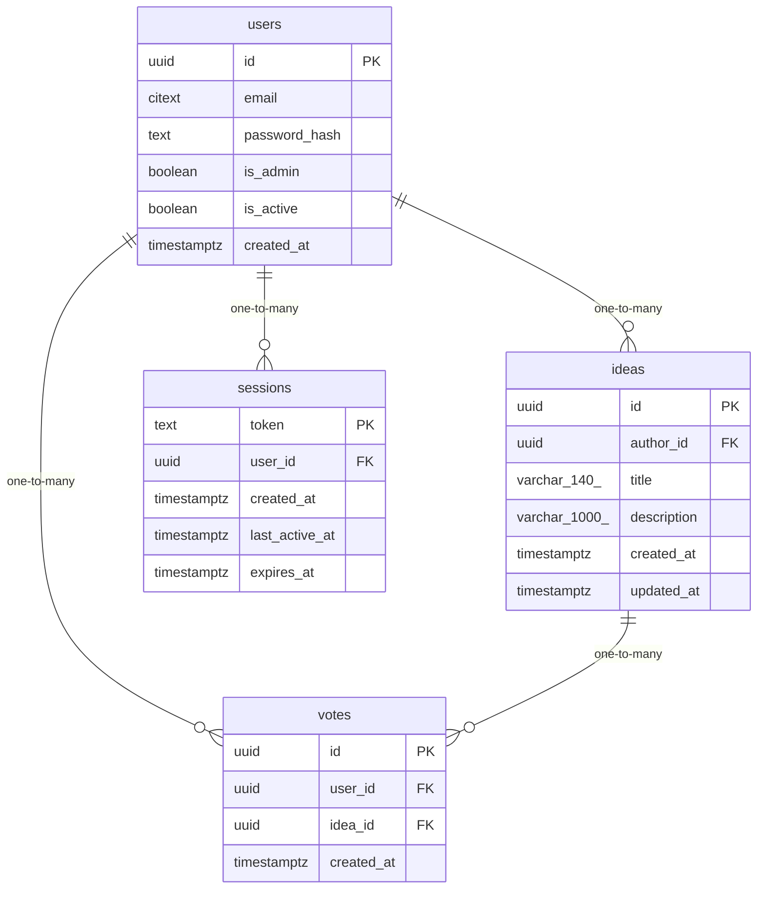

# Data Model

<!-- sdlc:auto:start entities -->
### users

| Field | Type | PK | FK | Nullable |
|---|---|---|---|---|
| id | uuid | True | — | False |
| email | citext | False | — | False |
| password_hash | text | False | — | False |
| is_admin | boolean | False | — | False |
| is_active | boolean | False | — | False |
| created_at | timestamptz | False | — | False |

### ideas

| Field | Type | PK | FK | Nullable |
|---|---|---|---|---|
| id | uuid | True | — | False |
| author_id | uuid | False | users.id | False |
| title | varchar(140) | False | — | False |
| description | varchar(1000) | False | — | False |
| created_at | timestamptz | False | — | False |
| updated_at | timestamptz | False | — | False |

### votes

| Field | Type | PK | FK | Nullable |
|---|---|---|---|---|
| id | uuid | True | — | False |
| user_id | uuid | False | users.id | False |
| idea_id | uuid | False | ideas.id | False |
| created_at | timestamptz | False | — | False |

### sessions

| Field | Type | PK | FK | Nullable |
|---|---|---|---|---|
| token | text | True | — | False |
| user_id | uuid | False | users.id | False |
| created_at | timestamptz | False | — | False |
| last_active_at | timestamptz | False | — | False |
| expires_at | timestamptz | False | — | False |
<!-- sdlc:auto:end entities -->

<!-- sdlc:auto:start relationships -->
| Source | Target | Type |
|---|---|---|
| users | ideas | one-to-many |
| users | votes | one-to-many |
| ideas | votes | one-to-many |
| users | sessions | one-to-many |
<!-- sdlc:auto:end relationships -->

<!-- sdlc:auto:start er-diagram -->

<!-- sdlc:auto:end er-diagram -->
